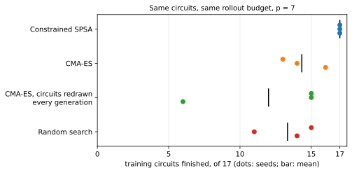
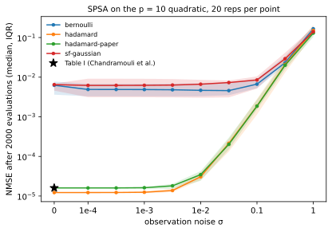

# Constrained SPSA for autonomous sim racing

Tuning a LIDAR racing controller with two-timescale constrained SPSA: minimise lap time
**subject to finishing every lap**, over a distribution of circuits. Built for the
[AutoDRIVE RoboRacer](https://github.com/AutoDRIVE-Ecosystem/AutoDRIVE-RoboRacer-Sim-Racing)
sim-racing league; all algorithm work runs on `f1tenth_gym`, which is bit-for-bit
deterministic and runs ~2,650 steps/s per core.

## Problem

A Follow-the-Gap controller drives from a 1080-beam LIDAR. Tune its gains θ ∈ [0,1]^p
(p = 6-8) on 22 real circuits (17 train, 5 test):

    min_θ  J(θ) = E_M[ lap(θ, M) / baseline(M) ]    s.t.   P(lap not completed) ≤ α

An unfinished lap is charged `budget / progress`, so every failure costs more than every
finish. The objective has a 42x cliff at infeasibility, with the optimum right against it.

## Method

Two-timescale constrained SPSA: simultaneous perturbations on the Lagrangian, projected
dual ascent on the completion constraint, and a **fresh pair of circuits drawn every
iteration**. The box midpoint is the baseline controller, so every run starts feasible,
and every evaluation carries a control that must read exactly 1.0000.

## Results

Normalised lap time: each lap divided by that circuit's lap with **untuned Follow-the-Gap**
(the centre of the tuning box, measured once per circuit), so baseline = 1.000 and lower is
faster. The baseline is our own, not a published one. Absolute lap times are not comparable with
other f1tenth benchmarks, whose maps and speed limits differ.

| controller | circuits | finished | lap time |
|---|---|---|---|
| shipped | **train** (17) | 17/17 | **0.596** |
| shipped | **held out**: Montreal, outside the 22 | 1/1 | 0.540 |
| shipped | train, driven in reverse (17) | 17/17 | 0.595 |
| earlier, same method | **train** (17) | 17/17 | 0.659 |
| earlier, same method | **held out**: the 5 test circuits | **5/5** | **0.685** |

The shipped controller was never run on the 5 test circuits, which had already been used
twice. Reliability against black-box search on the train circuits, same rollout budget,
3 seeds: constrained SPSA 17.0/17, CMA-ES 14.3/17, random search 13.3/17.

**Findings**

1. **The constraint is what separates SPSA from black-box search.** Random search and
   CMA-ES overfit the circuits they select on. Giving CMA-ES the same per-iteration
   circuit redraw makes it worse (12.0/17): the ranking changes every generation.

   

   *Training circuits finished, of 17, per seed. Data: `results/fig2_reliability.csv`.*
2. **Perturbations on a deterministic objective.** On the synthetic testbed (Table I of
   Chandramouli et al. reproduced exactly), a Hadamard cycle beats Bernoulli by ~500x with
   no noise, and every family converges by σ = 0.3. On racing, no family wins with two
   measurements (n = 10); one-measurement Hadamard matches or beats two-measurement
   Bernoulli at the same rollout count.

   

   *The synthetic testbed: deterministic (Hadamard) perturbations win by ~500x without noise,
   and the advantage is gone by σ = 0.3. The star is Table I. Data: `results/fig1_sweep.csv`.*
3. **The dual.** From a feasible start the constraint estimate never sits near α, so the
   multiplier follows its own step schedule; there is no equilibrium to track. The
   *magnitude* of the constraint channel is what matters: weakened 6.67x, feasibility broke
   for the first time in 36 runs.
4. **Parameterisation mattered more than algorithm.** A PPO residual on the earlier
   controller was 17-20% faster where it finished, but finished 17/17 in one seed of three.
   Its whole gain decomposed into a missing throttle-offset coordinate and a corner
   let-off; both went back into the controller, which is where the shipped one came from.
   This is not an SPSA-vs-PPO comparison.

**Limitations.** Three seeds per cell; one truly out-of-sample circuit for the shipped
controller; the test set was used twice, on earlier controllers. Transfer to AutoDRIVE is
in progress.

The shipped gains are `DELIVERABLE` in `scripts/follow_the_gap.py`. The run that tuned them:

```bash
.venv/bin/python scripts/spsa_racing.py --backend f1tenth --c3 --tracks-per-iter 2 \
    --iters 200 --timeout 250 -a 0.042 --seed 0 \
    --gains FOV,BUBBLE_R,GAP_THRESH,MAX_THROTTLE,MAX_STEER,CLEARANCE,THR_OFFSET:-0.40:0.40
```

## Contents

| File | What it does |
|---|---|
| `scripts/roboracer_env.py` | ROS 2 interface and `gymnasium.Env`; the frozen observation/action contract |
| `scripts/f1tenth_iface.py` | `f1tenth_gym` behind the same interface, for unattended runs |
| `scripts/follow_the_gap.py` | Follow-the-Gap reactive controller — the performance baseline |
| `scripts/circuits.py` | The 22-circuit set, the frozen baselines, and the train/test split |
| `scripts/fetch_circuits.py` | Downloads the circuit maps |
| `scripts/spsa_racing.py` | SPSA and constrained primal-dual SPSA on the racing objective |
| `scripts/spsa_testbed.py` | SPSA on synthetic objectives, for gain and perturbation studies |
| `scripts/spsa_bias.py` | Measures SPSA's gradient bias against an exact expectation |
| `scripts/parallel_eval.py` | Scores many gain sets at once, one simulator per worker |
| `scripts/rl_baseline.py` | PPO baseline, scored through the same rollout as everything else |
| `scripts/plot_results.py` | Draws the README's figures and writes the data behind them |
| `scripts/runlog.py` | Records each run's code, inputs and output hashes so results can be cited |
| `scripts/trackmap.py` | AutoDRIVE transfer: speed set-point, encoder odometry, LIDAR map and localiser |
| `scripts/dash.py` | AutoDRIVE transfer: live dashboard for a fine-tuning run |

## Quick start

Every script has a self-test that needs **no ROS, no simulator and no gymnasium** —
only `numpy`. Start here to check the logic runs:

```bash
python3 scripts/roboracer_env.py   --selftest
python3 scripts/follow_the_gap.py  --selftest
python3 scripts/spsa_testbed.py    --selftest
```

The rest need the project venv, because they drive a simulator:

```bash
.venv/bin/python scripts/circuits.py      --selftest   # needs data/baseline_ftg.csv
.venv/bin/python scripts/f1tenth_iface.py --selftest   # needs f1tenth_gym
.venv/bin/python scripts/spsa_racing.py   --selftest
.venv/bin/python scripts/spsa_bias.py     --selftest
.venv/bin/python scripts/rl_baseline.py   --selftest   # needs stable-baselines3
```

`runlog.py --selftest` needs nothing but the standard library. Every experiment is run
through it, so each result can name the code and the bytes that produced it:

```bash
.venv/bin/python scripts/runlog.py run --name my-run --track out.csv -- \
    .venv/bin/python scripts/spsa_racing.py --backend f1tenth --out out.csv
.venv/bin/python scripts/runlog.py verify
```

The SPSA testbed is entirely self-contained:

```bash
python3 scripts/spsa_testbed.py --family hadamard --sigma 0.01
python3 scripts/spsa_testbed.py --sweep
```

The two figures (needs `matplotlib`). Fig 1 regenerates from scratch. Fig 2 reads the
evaluation run records, which are kept locally and not in this repo, so its data is
committed as `results/fig2_reliability.csv`:

```bash
python3 scripts/spsa_testbed.py --sweep --out scratch/outreach/sweep_quadratic.csv
python3 scripts/plot_results.py
```

## Running against the simulator

Requires the AutoDRIVE simulator and devkit containers from the
[upstream repository](https://github.com/AutoDRIVE-Ecosystem/AutoDRIVE-RoboRacer-Sim-Racing).
Three terminals — each command blocks, so they cannot share one:

```bash
xhost +local:root

# A — simulator container, then inside it:
./AutoDRIVE\ Simulator.x86_64

# B — devkit container, then inside it:
ros2 launch autodrive_roboracer bringup_headless.launch.py

# C — into the same devkit container:
python3 follow_the_gap.py
```

In the simulator GUI, set **Driving Mode to Autonomous** and connect the bridge at
`127.0.0.1:4567`. The bridge is the server and the simulator is the client, so B must
be running before you connect. In Manual mode the commands are silently ignored.

Mount this repo into the devkit container to reach the scripts:

```bash
-v /path/to/this/repo/scripts:/home/scripts:ro
```

## The interface

Both controllers and the environment are written against one contract:

```
action = [steering, throttle]            each in [-1, 1]
obs    = [54 LIDAR bins in [0, 1]]       min-pooled from the 1080-beam scan
       + [speed / max_speed]            8.0 on AutoDRIVE, 15.0 on f1tenth
       + [previous action]               -> 57 floats
```

`RoboRacerInterface` is plain ROS 2 plumbing with no gym dependency, so classical
controllers use it directly. `RoboRacerEnv` wraps it to add spaces, reward and
termination.

Two details worth knowing if you extend this:

- The LIDAR is **min-pooled**, not subsampled. A thin obstacle falling between sampled
  beams would otherwise vanish from the observation.
- `max_speed` normalises the speed channel and is **the simulator's own top speed**, not a
  limit. Leaving it at AutoDRIVE's 8.0 on f1tenth, which commands 15.0, saturates the
  channel in exactly the racing regime.
- `reset_command` is latched by the bridge and never acknowledged, so `reset()` pulses
  it and then **confirms from telemetry** — the lap timer running backwards, or the car
  teleporting — rather than assuming it worked.

## Requirements

`numpy` for the self-tests. `rclpy` and ROS 2 Humble for the ROS interface (present in
the devkit container). `gymnasium` only for `RoboRacerEnv`, imported lazily so the rest
of the module works without it. `f1tenth_gym` for the unattended backend, and
`stable-baselines3` with CPU `torch` for the PPO baseline — the simulator is the
bottleneck, so a GPU build buys nothing.

## References

- Sezer & Gokasan, *A novel obstacle avoidance algorithm: Follow the Gap Method*,
  Robotics and Autonomous Systems 60(9), 2012.
- Spall, *Multivariate Stochastic Approximation Using a Simultaneous Perturbation
  Gradient Approximation*, IEEE Transactions on Automatic Control 37(3), 1992.
- Spall, *An Overview of the Simultaneous Perturbation Method for Efficient
  Optimization*, Johns Hopkins APL Technical Digest 19(4), 1998.
- Chandramouli, Prabuchandran, Sai Koti Reddy & Bhatnagar, *Generalized Deterministic
  Perturbations for Stochastic Gradient Search*, arXiv:1702.06250.
- Bhatnagar, Fu, Marcus & Wang, *Two-Timescale Simultaneous Perturbation Stochastic
  Approximation Using Deterministic Perturbation Sequences*, ACM TOMACS 13(2), 2003.
- Samak et al., *AutoDRIVE: A Comprehensive, Flexible and Integrated Digital Twin
  Ecosystem*, Robotics 12(3):77, 2023.
