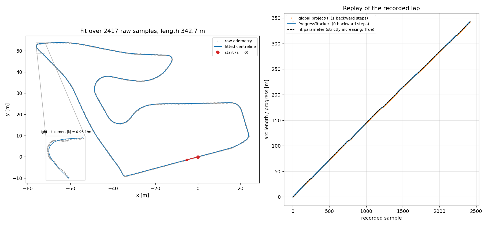
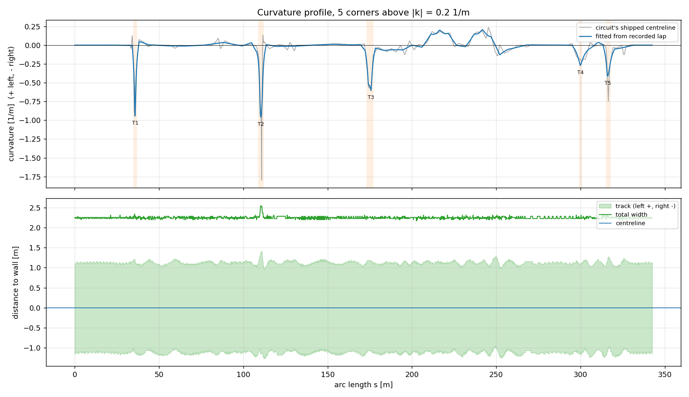
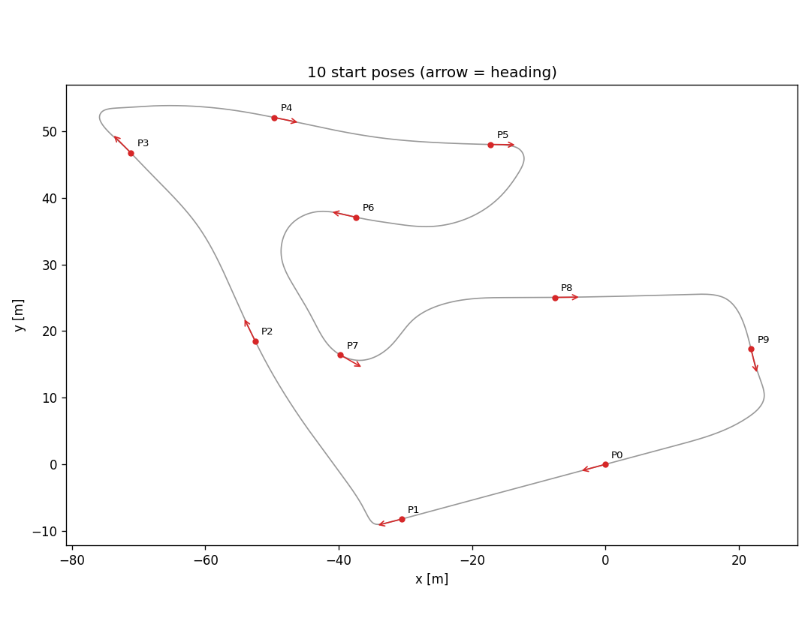
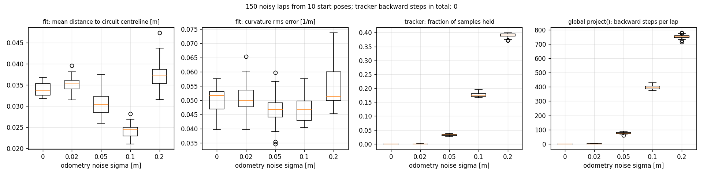

# P3: Track representation and the reference centreline

**Track:** Spielberg (f1tenth_gym). **Branch:** `feature/p3-centreline-v2`.
**Code:** `centreline/`. **Data and figures:** `results/p3_centreline/`.

## 1. Summary

A single recorded lap of noisy odometry is turned into a smooth closed curve,
parameterised by arc length. For any query point the module returns position
along the lap, signed lateral offset and curvature. It also provides a
track-width profile and ten verified start poses.

The property P3 is judged on is that **progress never goes backwards**:

| Check | Result |
|---|---|
| Recorded lap replayed: arc length of each sample (fit parameterisation) | strictly increasing at all 2417 samples |
| Recorded lap replayed through `ProgressTracker` | 0 backward steps, 1.000 laps |
| 150 noisy laps (10 start poses × 5 noise levels × 3 seeds), tracker | 0 backward steps in total |
| The same 150 laps, global nearest-point projection | up to 752 backward steps per lap |

## 2. Assumptions

These were agreed before the work started. Each one is a place where the
problem statement had to be interpreted.

1. **Spielberg, not Porto.** Porto is not in the installed track set and the
   rest of the team runs on Spielberg.
2. **The "recorded lap" is driven by a controller, not a human.** Nobody drives
   by hand in simulation. Follow-the-Gap drives the lap because it uses no
   centreline, so the recording cannot depend on the thing it is used to build.
   Its lap (241.7 s) matches P2's baseline.
3. **Odometry noise is simulated.** The simulator's pose is exact, so Gaussian
   noise (σ = 0.02 m by default) is added to x and y. The exact pose is kept
   alongside for scoring.
4. **The circuit's shipped centreline is used only to check results**, never to
   build them. Its width columns are a constant 1.1 m placeholder, so width is
   measured on the occupancy map.
5. **No shared code was modified.** `sims/`, `scripts/` and `common/` are
   untouched. The existing `Centreline` API and CSV format are unchanged; new
   fields have defaults. Start poses use a subclass of `GymEnv` inside P3's
   tools.

## 3. D1: recorded lap, fitted spline

* Raw lap: `Spielberg_raw_lap.csv`, 2417 samples at 10 Hz, about 0.14 m apart.
* **Choosing the smoothing factor mattered more than the spline itself.** SciPy's
  default of 0 makes the curve pass through every noisy point. On synthetic data
  that made the lap up to 6× too long. On Spielberg a noise-only factor kept
  Follow-the-Gap's few-centimetre weave, producing phantom corners
  (max |κ| 1.86 1/m).
* The rule used is `s = 2N(σ̂² + tol²)`, with σ̂ estimated from second
  differences (0.021 m estimated against 0.020 m true) and `tol = 0.05 m` for
  the weave. Scored against the circuit's own centreline, this was at the
  optimum for both 0.02 and 0.05 m noise. It cut curvature error from 0.6 to
  0.05 1/m.
* Result: 342.7 m (circuit's own centreline: 343.4 m), 1713 points at 0.2 m.
* Bug fixed in the existing fit: with `per=True` SciPy treats the last input
  point as a copy of the first, so the last recorded sample was being merged
  into the start.

## 4. D2: never going backwards

`Centreline.project()` searches the whole track. Wherever the track runs close
to itself it can snap to the other side. On a synthetic 0.4 m hairpin with 8 cm
noise it crossed sides 20 times in one lap, with no error raised.

`ProgressTracker` remembers the last arc length and only searches a window
around it (2 m ahead, 0.5 m behind). A projection that lands slightly behind
(along-track noise) is **held** rather than reported. A position far outside
the window (a reset) re-localises without crediting progress. Laps are
unwrapped across the start/finish line.

On noisy data, *strictly* increasing and *never decreasing* are different
promises. When noise along the track exceeds the sample spacing, consecutive
recorded points really do lie behind each other, so no position-only method
can be strictly increasing. Two things are delivered:

* `Centreline.source_arc_length` is the arc length of every recorded sample,
  from the parameter the fit assigned it. That parameter follows recording
  order, so it is strictly increasing by construction. This is the D2 replay.
* For live queries the tracker guarantees *never decreasing*. The held
  fraction is reported in §6.

## 5. D3: curvature, width, start poses

* **Curvature:** 5 right-hand corners above 0.2 1/m (tightest radius 1.04 m).
  RMS error against the circuit's own curvature is 0.047 1/m, and the fit is
  smoother than the shipped reference, which has single-point spikes.
* **Width (occupancy map):** min 2.17, median 2.26, max 2.55 m. The fitted
  centreline is 2.9 cm off the true middle (median), and no sample lies on a
  wall.
* **Start poses:** 10 poses (two spare over the eight required), spread
  evenly, kept out of corners, 3 m before them, and sections narrower than
  1.5 m.

Verification in f1tenth_gym (`Spielberg_start_pose_checks.csv`): **10/10 pass.**
Each has ≥ 1.04 m clearance to each wall, no spawn collision, heading within
0.0–3.3° of the circuit's own centreline, and 11.8–15.0 m of progress in 10 s.
**Negative control:** every pose spawned reversed fails (0.0 m progress), so
the check does tell forward from backward.

## 6. D4: robustness

One lap from each of the 10 poses (all complete, no collisions, 240.7–243.9 s),
then noise added offline. 150 noisy laps in total.

| σ [m] | fit: mean dist [m] | fit: κ rms [1/m] | fit: samples strictly increasing | tracker: backward steps | tracker: held | tracker: laps | global: backward steps / lap |
|---|---|---|---|---|---|---|---|
| 0.00 | 0.034 | 0.050 | 30/30 | 0 | 0.00 | 1.000 | 0 |
| 0.02 | 0.035 | 0.051 | 30/30 | 0 | 0.00 | 0.999–1.000 | 0.4 |
| 0.05 | 0.030 | 0.046 | 30/30 | 0 | 0.03 | 0.999–1.000 | 77 |
| 0.10 | 0.024 | 0.047 | 30/30 | 0 | 0.18 | 0.999–1.000 | 396 |
| 0.20 | 0.037 | 0.055 | 30/30 | 0 | 0.39 | 0.999–1.002 | 752 |

Fit quality hardly depends on noise, because the smoothing scales with the
estimated σ. The cost of never going backwards is holding: at 0.2 m noise, 39%
of samples report no advance. The distance still comes out right over the lap
(0.999–1.002 laps).

## 7. Limitations

* Porto has not been tested. Every number here is Spielberg.
* The noise model is white Gaussian. Real wheel odometry drifts slowly (the
  error is correlated over time), which is easier for the tracker but harder to
  undo in the fit.
* Spielberg's centreline never comes closer to itself than 8.5 m (between
  parts more than 20 m apart along the lap), so on the real track
  the global projection fails only through noise. The close-hairpin case is
  shown on synthetic data (`centreline/tests/test_replay.py`).
* `window_ahead` must exceed the distance travelled between updates. 2 m allows
  40 m/s at 20 Hz.

## 8. Reproduce

See `centreline/info.txt`. Seven commands, about 6 minutes in total.
Tests: `python -m pytest centreline`.
